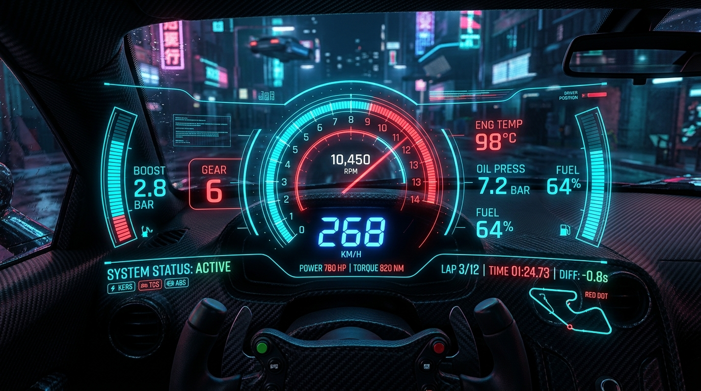
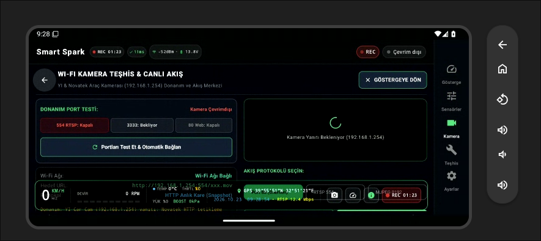
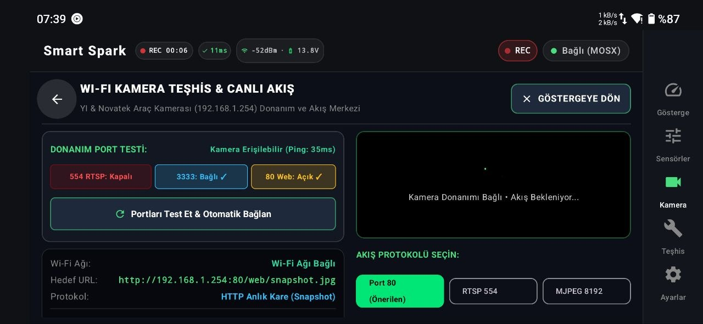
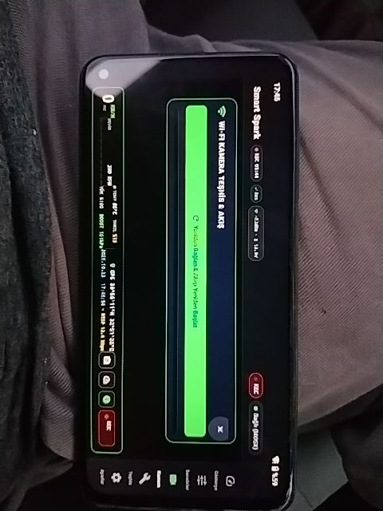
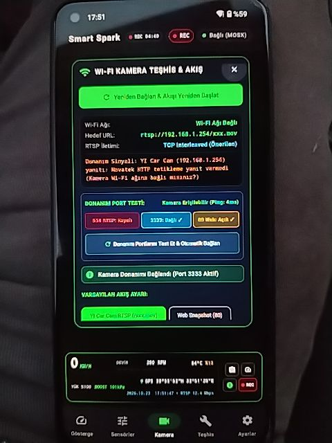
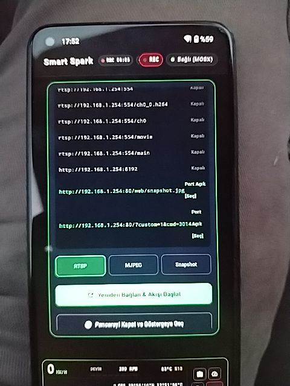

# ⚡ Smart Spark | OBD2 Telemetry & WiFi Dashcam HUD

<div align="center">



[](https://developer.android.com)
[](https://kotlinlang.org)
[](https://developer.android.com/jetpack/compose)
[](https://m3.material.io)
[](https://github.com)
[](https://github.com)
[](https://ai.google.dev)

**Yeni Nesil Siber Araç Telemetrisi, Canlı WiFi Dashcam Görüntü Akışı ve AI Destekli Sürüş Paneli**

[Özellikler](#-öne-çıkan-özellikler) • [Ekran Görüntüleri](#-ekran-görüntüleri) • [Kamera Protokolü](#-novatek--yi-dashcam-protokol-çözümü) • [Kurulum](#-kurulum--başlangıç) • [Mimari](#-mimari--teknoloji-yığını)

</div>

---

## 🌟 Proje Özeti

**Smart Spark**, aracınızı geleceğin kokpitine dönüştüren hepsi-bir-arada bir **Head-Up Display (HUD)**, **OBD2 Canlı Telemetri** ve **WiFi Araç Kamerası (Dashcam)** izleme uygulamasıdır. 

Sıradan fabrika kadranlarını geride bırakın! Yüksek kontrastlı **karbon fiber dokular**, **elektrik camgöbeği (cyan)** ve **agresif yarış kırmızısı (sport red)** temasıyla tasarlanan arayüz, hem gündüz hem gece sürüşlerinde maksimum okunabilirlik ve nefes kesici bir siberpunk estetiği sunar.

---

## 🔥 Öne Çıkan Özellikler

### 🏎️ 1. Ultra Akıcı Yarış Kadranları & HUD
* **Hız & Devir Göstergesi (RPM & Speedometer):** Gerçek zamanlı gaz tepkisine duyarlı, 60 FPS akıcı ibre ve dijital sayaçlar.
* **Kritik Motor Telemetrisi:** Turbo Basıncı (Boost / MAP), Motor Soğutma Suyu Harareti (Coolant Temp), Emme Havası Sıcaklığı (IAT), Gaz Kelebeği Açıklığı (Throttle %) ve Akü Voltajı.
* **Dinamik Uyarı Kadranları:** Limit devirde parlayan vites lambaları (shift-lights) ve eşik aşımlarında devreye giren spor kırmızı uyarı animasyonları.

### 📹 2. Canlı WiFi Araç Kamerası (Dashcam) Entegrasyonu
* **Tam Ekran & HUD Üzerine Bindirme (Overlay):** Kamera görüntüsünü tek dokunuşla tam ekran yapabilir veya göstergelerin arkasında şeffaf bir canlı vizör olarak çalıştırabilirsiniz.
* **Novatek NT966xx & YI Car Cam Uyumluluğu:** Piyasadaki popüler tüm WiFi araç kameralarını otomatik algılar ve kilitleri çözer.
* **Çoklu Protokol Desteği:**
  * **RTSP (Port 554):** Düşük gecikmeli H.264 video yayını (`rtsp://192.168.1.254/`).
  * **HTTP MJPEG (Port 8192):** Sürekli canlı kare ayrıştırma motoru (`http://192.168.1.254:8192`).
  * **Snapshot / Fotoğraf Modu (Port 80):** Bant genişliğini koruyan anlık kare çekimi.

### 🔌 3. Entegre Donanım & Port Teşhis Aracı (Diagnostic Matrix)
* **Canlı Ping & Yanıt Süresi Ölçümü:** Kameranın ağda aktif olup olmadığını ms cinsinden ölçer.
* **Gerçek Zamanlı Port Taraması:**
  * `554 (RTSP Video)`
  * `8192 (MJPEG Stream)`
  * `3333 (Notification & Keep-Alive Socket)`
  * `80 (Web CGI API & Komut Portu)`
* **1-Dokunuşla Otomatik Uyandırma:** Kamera SD karta kayıt yaparken video kodlayıcıyı otomatik serbest bırakıp RTSP sunucusunu ayağa kaldıran akıllı el sıkışma motoru.

### 🚗 4. ELM327 Bluetooth OBD2 & ECU Teşhisi
* Standart ELM327 / OBDLink Bluetooth adaptörleriyle sıfır gecikmeli bağlantı.
* Gerçek zamanlı sensör PID sorgulama.
* Arıza lambası (MIL / Check Engine) durum tespiti ve DTC arıza kodu okuma.

### 🧭 5. G-Force Matrisi & Eğim Sensörü (IMU Gyro)
* **2D G-Force Vektörü:** Virajlardaki yanal (lateral) ve kalkış/frendeki boylamsal (longitudinal) ivmeleri anlık gösteren dağılım grafiği.
* **Pitch & Roll Göstergesi:** Pist veya arazi koşullarında aracın gövde eğimini takip eden yapay ufuk göstergesi.

### 🤖 6. Gemini AI Sürüş ve Arıza Asistanı
* Aracınızdan gelen telemetri verilerini ve arıza kodlarını analiz ederek anında sürücüye özel performans ve bakım tavsiyeleri sunar.

### 🕹️ 7. Sanal Simülatör (Offline Sandbox Modu)
* Arabanızın yanında değil misiniz? Tek bir tuşla **Sanal Sürüş Simülasyonu**nu açarak tüm kadranları, limit devir seslerini ve ivme animasyonlarını evinizdeki koltuktan deneyimleyin!

---

## 📸 Ekran Görüntüleri

<div align="center">

### 🏁 Canlı Gösterge Paneli & HUD Telemetrisi
*Hız, Devir, Turbo Basıncı, Motor Sıcaklıkları ve G-Kuvveti Kadranları*



---

### 📹 Tam Ekran WiFi Dashcam Akışı & Canlı Port Teşhisi
*Kamera donanım bağlantısı, açık port durumları ve video akış penceresi*



---

### 📱 Dikey Mobil Arayüz & Donanım Teşhis Matrisi

| Dikey Sürüş Ekranı | Donanım Port Taraması | Kamera Bağlantı Ayarları |
| :---: | :---: | :---: |
|  |  |  |
| *Yüksek kontrastlı dikey göstergeler* | *Canlı Ping ve Port (554, 8192, 3333, 80) durumları* | *IP, Port ve RTSP/MJPEG protokol seçimi* |

</div>

---

## 🛠️ Novatek & YI Dashcam Protokol Çözümü

Novatek tabanlı araç kameraları açıldıklarında doğrudan SD karta kayıt başlatır. Bu durum kameranın dâhili donanım enkoderini meşgul ettiğinden **Port 554 RTSP** varsayılan olarak kapalı durur.

**Smart Spark**, donanım kilidini açmak için otomatik olarak şu mikro-komut dizisini icra eder:

```
[1] HTTP GET http://192.168.1.254/?custom=1&cmd=2001&par=0   --> SD Kaydını Durdur (Enkoderi Boşa Çıkar)
[2] HTTP GET http://192.168.1.254/?custom=1&cmd=3001&par=1   --> Video / Movie Moduna Geçir
[3] HTTP GET http://192.168.1.254/?custom=1&cmd=2019         --> RTSP Daemon'ını Başlat & <MovieLiveViewLink> Adresini Al
[4] HTTP GET http://192.168.1.254/?custom=1&cmd=2008         --> Canlı Yayını Başlat
[5] RTSP / MJPEG Bağlantısı Kurulur (Port 554 veya Port 8192 Açılır)
```

Bu sayede ek bir komut satırı veya üçüncü parti uygulamaya gerek kalmadan **tek tıkla video akışı başlar**.

---

## 🚀 Kurulum & Başlangıç

### Gereksinimler
* Android 8.0 (Oreo) veya üzeri (Tavsiye edilen: Android 12+)
* Bluetooth destekli bir Android cihaz (ELM327 OBD2 için)
* Dahili Wi-Fi (Araç kamerasına bağlanmak için)

### Adım Adım Başlatma

1. **Repoyu Klonlayın:**
   ```bash
   git clone https://github.com/your-username/smart-spark.git
   cd smart-spark
   ```
2. **Projeyi Derleyin:**
   ```bash
   ./gradlew assembleDebug
   ```
3. **Araca Bağlantı:**
   * **OBD2:** ELM327 adaptörünü aracınızın OBD2 portuna takın, telefonunuzun Bluetooth ayarlarından eşleştirin ve uygulamada **OBD Bağlan** butonuna basın.
   * **Dashcam:** Telefonunuzun Wi-Fi ayarlarından araç kamerasının yayınına (örneğin `YICarCam_xxxx` veya `Novatek_xxxx`) bağlanın (varsayılan IP: `192.168.1.254`).
   * Uygulamadaki **Kamera** simgesine dokunun; donanım otomatik taranıp canlı akış ekrana yansıtılacaktır!

---

## 🏗️ Mimari & Teknoloji Yığını

* **Kullanıcı Arayüzü (UI):** [Jetpack Compose](https://developer.android.com/jetpack/compose) & [Material Design 3](https://m3.material.io) (Tamamen reaktif, donanım hızlandırmalı Canvas çizimleri)
* **Asenkron Yapı:** [Kotlin Coroutines](https://kotlinlang.org/docs/coroutines-overview.html) & `StateFlow`
* **Video Akış Çözücüleri:**
  * **RTSP:** AndroidX Media3 / ExoPlayer RTSP Extension
  * **MJPEG:** Düşük gecikmeli, non-blocking JPEG SOI (`0xFF, 0xD8`) ve EOI (`0xFF, 0xD9`) bayt ayrıştırıcısı
* **Ağ & Soket:** Standart Java NIO / TCP Sockets, OkHttp & HTTP CGI Client
* **Yapay Zekâ Motoru:** Google Gemini API (AI Studio SDK)
* **Sensör Entegrasyonu:** Android Sensor Framework (Linear Acceleration, Gravity & Gyroscope)

---

## 📄 Lisans

Bu proje açık kaynak topluluğu ve araç tutkunları için geliştirilmiştir. Ayrıntılar için `LICENSE` dosyasına göz atabilirsiniz.

<div align="center">
  <sub>Geliştirici: <b>Fatih Esen</b> • <i>Command your machine. Master the data. 🏁</i></sub>
</div>
